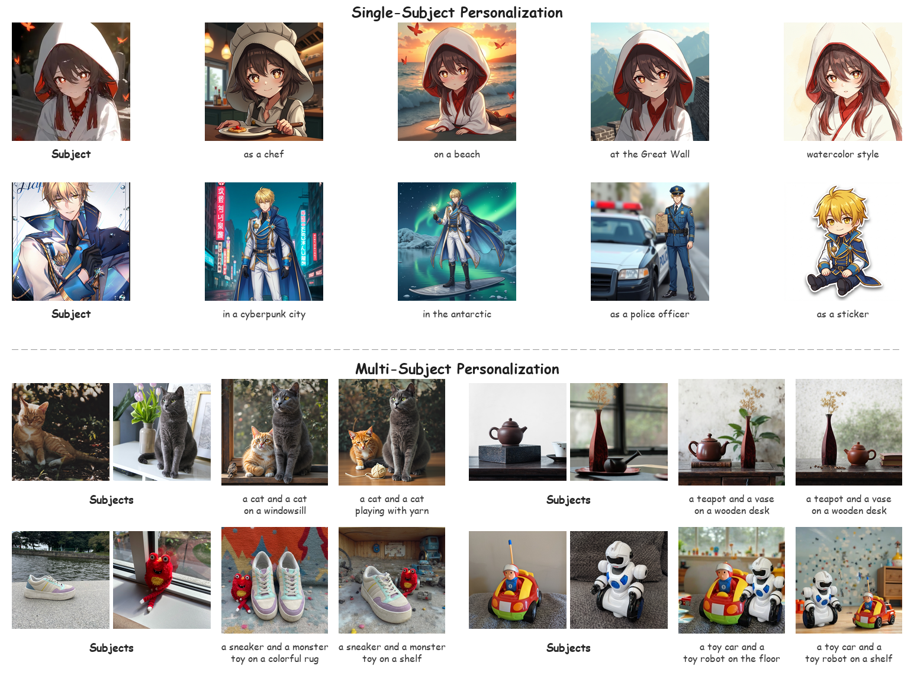

# ARIA: Architecture-aware Routing for Identity-preserving Attention

**Multi-subject personalization in Diffusion Transformers, training-free.**

ARIA achieves state-of-the-art identity preservation for multi-subject image generation by exploiting a fundamental *architectural asymmetry* in MMDiTs: joint-stream blocks propagate cross-subject contamination during identity injection, while single-stream blocks preserve subject fidelity.



## Method

ARIA consists of three components:

- **LSI (Layer-Selective Injection):** Restricts reference KV concatenation to single-stream blocks only, avoiding contamination in joint-stream blocks.
- **GIA (Group Isolation Attention):** Partitions attention so each subject's queries attend only to its own reference features, preventing cross-subject identity mixing.
- **CPD (Concept Position Decoupling):** Assigns each subject distinct RoPE positional regions, preventing shared positional encoding from biasing subjects toward overlapping spatial locations.

Built on top of [Personalize Anything](https://github.com/fenghora/personalize-anything) and [FLUX.1-dev](https://huggingface.co/black-forest-labs/FLUX.1-dev).

## Installation

```bash
git clone https://github.com/YOUR_USERNAME/ARIA.git
cd ARIA

conda create -n aria python=3.10
conda activate aria

pip install torch torchvision --index-url https://download.pytorch.org/whl/cu118
pip install -r requirements.txt
```

## Quick Start

### Single-subject personalization

```bash
python inference_single.py
```

### Multi-subject personalization

```bash
python inference_multi.py
```

### Gradio demo

```bash
python gradio_demo.py
```

## Project Structure

```
ARIA/
├── src/
│   ├── aria_processor.py      # ARIA attention processors (LSI + GIA + CPD)
│   ├── attn_processor.py      # Base attention processor
│   ├── pipeline.py            # FLUX diffusion pipeline with RF-Inversion
│   └── utils.py               # Mask creation and image utilities
├── inference_single.py        # Single-subject example
├── inference_multi.py         # Multi-subject example
├── gradio_demo.py             # Interactive web demo
├── example_data/              # Sample subjects with masks
├── assets/                    # README images
└── requirements.txt
```

## Custom Subjects

To use your own subjects, prepare a directory with:
- `background.png` — the reference image
- `mask.png` — binary mask of the subject region

You can generate masks automatically using [Grounded SAM](https://github.com/IDEA-Research/Grounded-Segment-Anything):

```bash
python scripts/grounding_sam.py --image your_subject/background.png --labels "your object"
```

## Acknowledgement

- [Personalize Anything](https://github.com/fenghora/personalize-anything) — base framework
- [diffusers](https://github.com/huggingface/diffusers)
- [RF-Inversion](https://github.com/LituRout/RF-Inversion)

## Citation

```bibtex
@article{aria2026,
  title={ARIA: Architecture-aware Routing for Identity-preserving Multi-Subject Personalization in Diffusion Transformers},
  author={Anonymous},
  year={2026}
}
```
